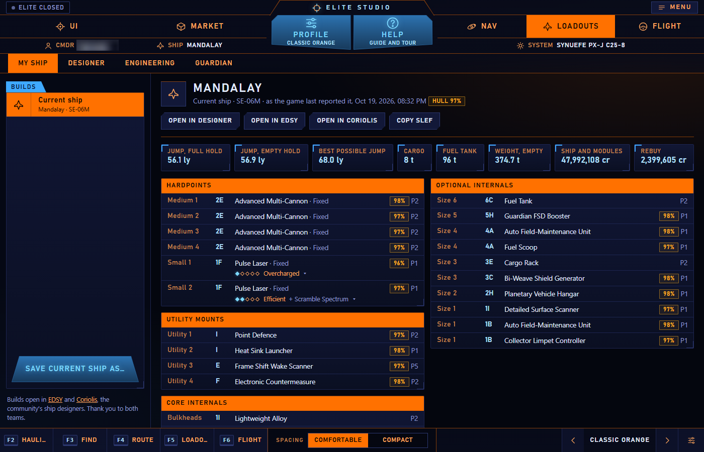
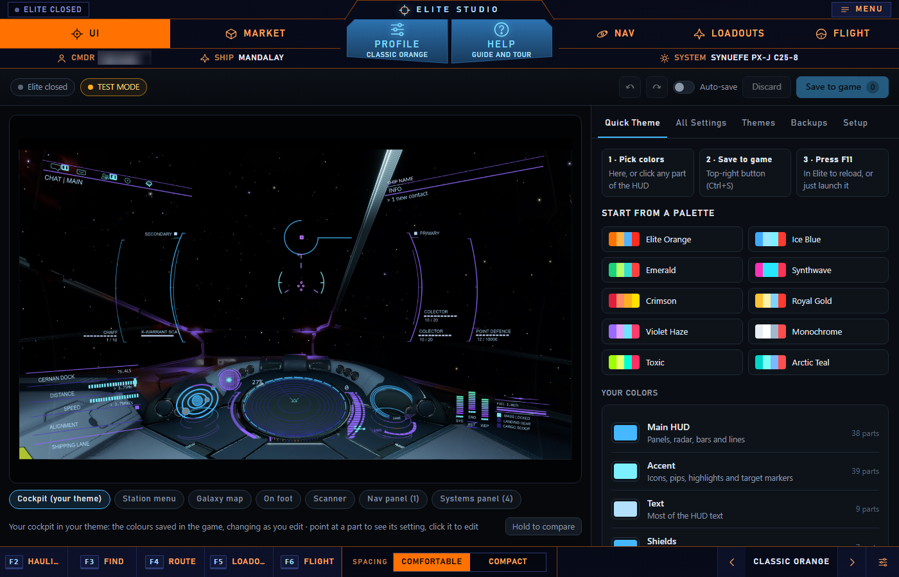
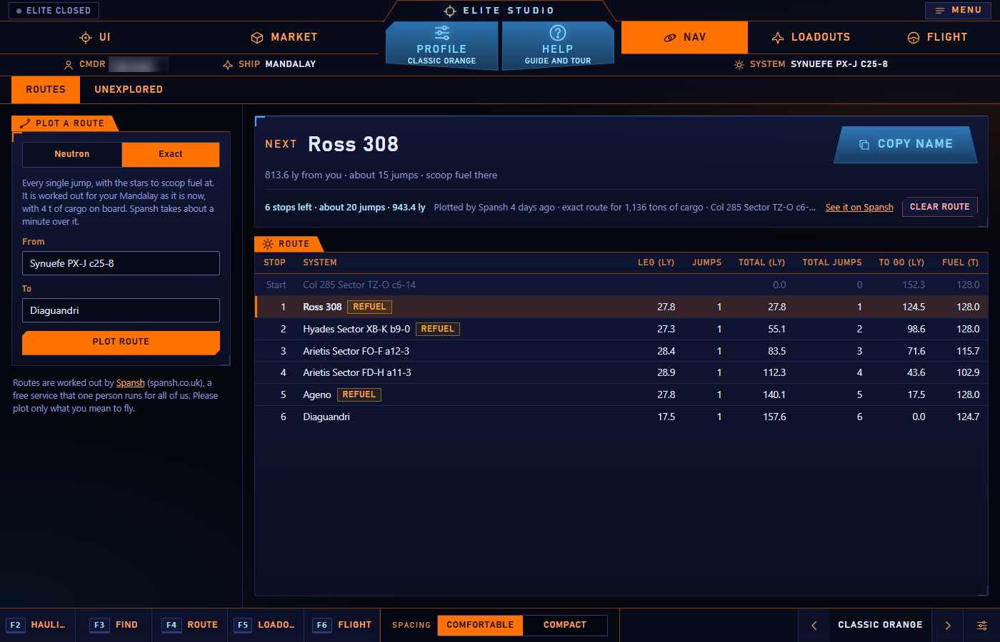
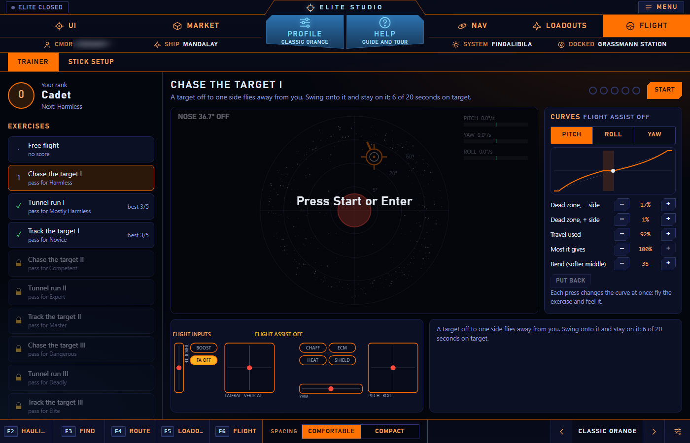

# Elite Studio

A companion app for **Elite Dangerous** on Windows. One window, five studios, and overlays you can call up inside the game.

Elite Studio reads the files the game itself writes (the journal, your ship, your cargo, your key bindings). It does not change the game and does not touch its memory.

## Screenshots

| | |
|---|---|
|  |  |
| **Studio Loadouts** — your ship as it is | **Studio UI** — your cockpit HUD in your own colours |
|  |  |
| **Studio Nav** — a route, one system at a time | **Studio Flight** — the Flight Assist off trainer |

## What it does

**Studio UI** — a theme editor for the cockpit HUD's colours, with a live preview. It works through the EDHM HUD mod (see Credits), which Studio fetches for you from its makers' own page.

**Studio Market**
- **Trades**: the best hauling trades for the ship you are flying, near you or anywhere, one way or round trip. Or name the system you are travelling to, and Studio lists what to buy at the station you are docked at and which station there pays most for it.
- **Find by name**: the nearest places that sell or buy a commodity, sell a module or a ship, or have a service. Or find a station by its own name and see its price list. Studio remembers the price list of every station whose market you open, and shows what a ton makes carried between that station and the one you are docked at. With fleet carriers included, a commodity search says who may dock at each one and leaves out those that do not let everyone in; a list that comes back short says how many more places your filters left out.
- **Sniffer**: save commodity searches with a price and an amount. Studio runs each one once an hour, anywhere in the galaxy, and can play a sound when one is met.

**Studio Nav** — plot routes and hand them to the galaxy map one system at a time; find unexplored space.

**Studio Loadouts** — your ship as it is, a ship designer, an engineering planner with a shopping list, and Guardian unlocks.

**Studio Flight** — for flying with Flight Assist off. A trainer that flies like the game with Flight Assist off (your ship's turn rates, momentum that carries on until you stop it), with nine exercises from Cadet to Elite: chase a target that flies away and keep it on your nose, fly a tunnel with bends, keep the nose on a moving dot. Beside each exercise, +/- buttons change your Flight Assist off curves as you fly, so you can feel each change at once. Three good attempts of five pass an exercise. Beside it: your stick's curves for Flight Assist off and on, a guided stick check (steps on screen with a timer) that finds where your stick rests, by itself and with your hand resting on it as in flight, sets your Flight Assist off dead zones to match (the trainer's exercises are then for the curves) and keeps a record of each check, your Elite flight bindings with what in them gets in the way, and for Joystick Gremlin users a copy of their profile with an "FA Off" mode that switches with the game's Flight Assist key.

**Studio's own look** — pick a look for the app itself under Profile: Classic Orange (the game's own colours, which Studio starts in), Velvet Ice (with a compact version), Space Dust, Firefly Grove, Earthen Flight or Frost, with comfortable or compact spacing. Save your own looks, and share one with another commander as a code.

**Overlays in the game** — F2 hauling, F3 Find by name, F4 route, F5 loadouts, F6 flight inputs. Press the key to show one and work it with the mouse; press it again to hide it. Each has its own size and place. The flight inputs overlay (your throttle, thrusters, stick and buttons as you fly) never takes the mouse, and can show itself whenever Flight Assist is off.

## Install

1. Download **Elite Studio Setup** (the newest version) from the **Releases** page.
2. Run it and follow the steps. Windows asks once for permission, as it does for any program that installs for every user of the PC.

Studio installs to `C:\Program Files\Elite Studio`, with an entry in the Start menu and, if you tick it, a shortcut on the desktop. It runs on Windows 10 (version 2004 or later) or 11, 64-bit, and needs nothing else: .NET comes inside it, and the setup adds Microsoft's WebView2 Runtime (the web engine built into Windows 11 and most Windows 10 PCs) if your PC lacks it.

The installer is not code-signed yet, so Windows may show "Windows protected your PC" the first time. Click **More info**, then **Run anyway**.

**Updating:** run the newer setup. It closes Studio if it is running and installs over the old version; your settings and builds stay as they are.

**Uninstalling:** Windows Settings → Apps → Elite Studio → Uninstall. It asks whether to remove your settings and builds as well (it keeps them unless you say yes).

Closing the window only hides Studio. To exit, right-click its icon near the clock and choose **Exit**.

Studio keeps its settings, saved builds, themes and logs in `%LOCALAPPDATA%\Elite Studio`, never in the program's folder. Deleting that folder puts everything back to a first start.

## Where the data comes from

Market prices come from [Ardent Insight](https://ardent-insight.com/); stations, modules, ships and routes from [Spansh](https://spansh.co.uk/); exploration coverage from [EDAstro](https://edastro.com/). All three are free services that volunteers run for the whole community, fed by what players' tools report. An answer is as fresh as the last visit by one of those players. Studio asks them only when you search (and once an hour for a search you saved in the Sniffer), keeps answers for a few minutes instead of asking twice, and says who it is with every request.

The 3D map (Studio Nav, Unexplored, "3D map") is drawn from:
- **EDAstro's sector list**, the same list the flat map uses: how many systems are named after each sector. Studio fetches it (about 1.5 MB) only when you press the button, and keeps it for a week.
- **EDAstro's nebula list**, for names such as "California Nebula": fetched the same way (about 0.5 MB), only when you ask.
- **The nebula spheres and the reading of star names into places**, which ship with Studio: they come from EDTS (see Credits) and need no service at all.
- **Spansh's system search**, when you look inside a sector or a nebula, or count a cube. Studio asks for the count first (1 request), then lists the systems 500 to a request, one request at a time. Before anything over 5 requests it says how many requests and megabytes it will take and waits for your yes; it never asks again by itself after a failure, and it stops at 200 requests for the 3D map in one session. Cancel stops a listing between two pages.
- **Spansh's name suggestions**, in the Star field as you type (three letters or more, after a short pause): the same request, and the same answers kept for the session, as the name boxes of Routes. These are not counted in the 3D map's 200.
- **Your own journal**, for your first discoveries.

Everything Spansh answers is kept on your PC, with its date, in `%LOCALAPPDATA%\Elite Studio\heatmap`, so nothing is asked twice: "Survey again" asks afresh only when you press it, and a listing that was stopped goes on from the next page. A count is kept as soon as it comes, even when you then say no to the listing. A new listing made by "Survey again" is kept beside the earlier one until it is complete, so stopping it half way never loses the earlier list. None of it ships with Studio. The large download of every known system (6.4 GB) that would colour the busiest sectors cube by cube is not part of Studio yet.

## Build it yourself

You need the .NET 10 SDK, and [Inno Setup 6](https://jrsoftware.org/isinfo.php) (free) for the installer: `winget install JRSoftware.InnoSetup --source winget`.

```
powershell -ExecutionPolicy Bypass -File installer\Make-Installer.ps1
```

This runs the checks, builds Studio with .NET inside it, and makes `Elite Studio Setup <version>.exe` in a folder `Installers` beside the project's folder. The installer's recipe is `installer\EliteStudio.iss`; `-Test` makes a copy of it, "Elite Studio (test)", to try the installer with beside the real one.

To run the checks alone: `dotnet test EliteStudio.slnx`.

## Credits

- **EDHM** (Elite Dangerous HUD Mod) by psychicEgg and Fred89210 does the recolouring in the game. It is not part of Elite Studio and is not in this repository or its downloads: its licence does not allow passing it on. Studio downloads it from its makers for each player.
- **EDHM_UI** by Blue Mystic ([github.com/BlueMystical/EDHM_UI](https://github.com/BlueMystical/EDHM_UI), GPL-3.0), the mod's own editor. Studio UI's cockpit picture is made from EDHM_UI's cockpit picture (its HUD redrawn in your own colours, its badge and portrait taken out); the names and grouping of the settings, and the picture of the part each setting changes, are EDHM_UI's.
- **Ardent Insight**, **Spansh** and **EDAstro**, for the data services above. For the 3D map: Spansh's system search (by Gareth Harper), which counts and lists the systems inside a sector or a nebula; and EDAstro's sector list and nebula list (by CMDR Orvidius, all rights reserved, fetched only when you ask and never shipped), with the community nebula catalogue that EDAstro's nebula list is built from.
- **EDTS**, the Elite Dangerous Travel Scripts, by Esvandiary and Andy Martin ([bitbucket.org/Esvandiary/edts](https://bitbucket.org/Esvandiary/edts), BSD-3 licence): the 3D map's table of nebula and star cluster spheres (with which need a permit), and the reading of a generated star name such as "Wredguia WD-K d8-65" into the cube it names, after CMDR Jackie Silver's work on how the game makes those names. Its licence notice is under "Licence notices" below and in the files made from it.
- **Colour maps** of the 3D map: Heat follows matplotlib's Inferno by Nathaniel Smith and Stéfan van der Walt (CC0); Spectral uses the ten colours of the ED3D galaxy map's heat map (Copyright (c) 2015 Guillaume Perez, MIT licence); colours are blended in Björn Ottosson's OKLab colour space.
- **EDCD** (coriolis-data and FDevIDs) for the tables of ships, modules, engineering recipes and names. The numbers in them are Frontier's.
- **Coriolis** (MIT licence), whose open-source sums the ship designer's figures follow.
- **EDAssets** ([edassets.org](https://edassets.org/)) for the station pictures beside station names in Studio Market, redrawn after the game's own by CMDR SpyTec and Mat-2596. They are Frontier's designs, shared there with Frontier's permission for non-commercial use; the GPL licence below does not cover them. The fleet carrier picture is Studio's own.

Elite Dangerous is a trademark of Frontier Developments plc. Elite Studio is a fan-made tool and is not affiliated with or endorsed by Frontier Developments.

## Licence

GPL-3.0. See [LICENSE](LICENSE).

### Licence notices

Parts of the 3D map come from EDTS, whose licence asks that its notice travel with them:

```
Copyright (c) 2016, Andy Martin
All rights reserved.

Redistribution and use in source and binary forms, with or without
modification, are permitted provided that the following conditions are met:
    * Redistributions of source code must retain the above copyright
      notice, this list of conditions and the following disclaimer.
    * Redistributions in binary form must reproduce the above copyright
      notice, this list of conditions and the following disclaimer in the
      documentation and/or other materials provided with the distribution.
    * Neither the name of the EDTS Project nor the
      names of its contributors may be used to endorse or promote products
      derived from this software without specific prior written permission.

THIS SOFTWARE IS PROVIDED BY THE COPYRIGHT HOLDERS AND CONTRIBUTORS "AS IS" AND
ANY EXPRESS OR IMPLIED WARRANTIES, INCLUDING, BUT NOT LIMITED TO, THE IMPLIED
WARRANTIES OF MERCHANTABILITY AND FITNESS FOR A PARTICULAR PURPOSE ARE
DISCLAIMED. IN NO EVENT SHALL THE EDTS PROJECT OR ANDY MARTIN BE LIABLE FOR ANY
DIRECT, INDIRECT, INCIDENTAL, SPECIAL, EXEMPLARY, OR CONSEQUENTIAL DAMAGES
(INCLUDING, BUT NOT LIMITED TO, PROCUREMENT OF SUBSTITUTE GOODS OR SERVICES;
LOSS OF USE, DATA, OR PROFITS; OR BUSINESS INTERRUPTION) HOWEVER CAUSED AND
ON ANY THEORY OF LIABILITY, WHETHER IN CONTRACT, STRICT LIABILITY, OR TORT
(INCLUDING NEGLIGENCE OR OTHERWISE) ARISING IN ANY WAY OUT OF THE USE OF THIS
SOFTWARE, EVEN IF ADVISED OF THE POSSIBILITY OF SUCH DAMAGE.
```
